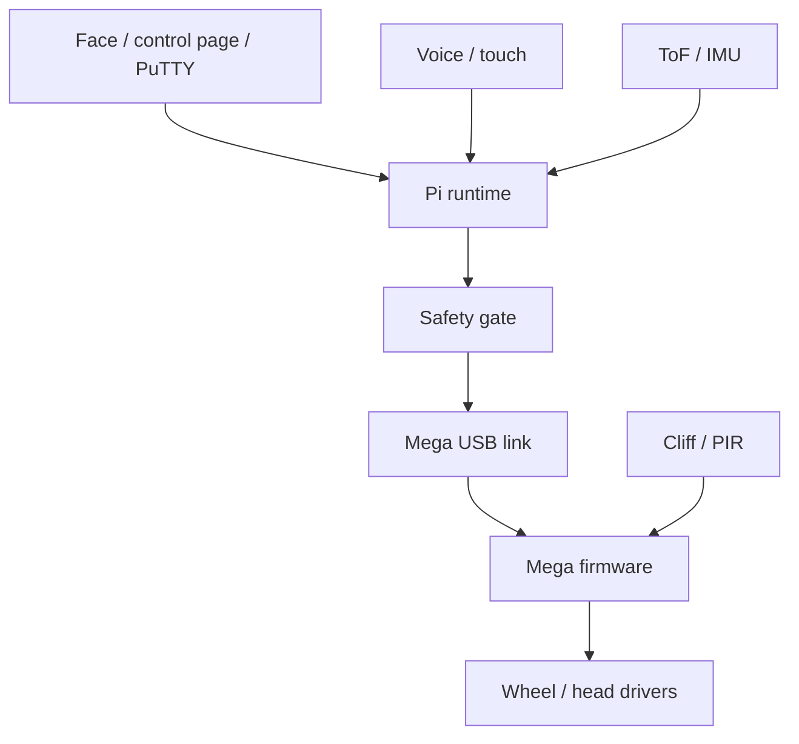

# Architecture and source map

One Python runtime owns the hardware. Web, CLI, voice and touch commands converge in `Runtime.execute`.
The Pi makes sensor-based decisions; the Mega independently enforces its cliff, heartbeat, enable and
motion-lease rules. The Mega does not directly read the Pi's distance or IMU sensors.

| Source | Responsibility |
|---|---|
| eve | Launcher; automatically selects .venv/bin/python |
| eve3/__main__.py | Config, single-instance lock, simulation option, server lifecycle |
| eve3/runtime.py | Composition, control/sensor/behavior threads, command allow-list |
| eve3/config.py | Defaults + owner overlay, validation, local settings persistence |
| eve3/protocol.py, mega_link.py | E1 frames, CRC16, sequence/ACK correlation, telemetry |
| eve3/firmware.py | Header generation and firmware-settings ID |
| eve3/sensors.py | Three-ToF address assignment, MPU6050 tilt, frame freshness, cliff calibration |
| eve3/safety.py, power.py | Refusal/latch rules and attended power sessions |
| eve3/motion.py | Drive duration/renewals; head manual home, jogs and soft limits |
| eve3/touch.py, camera.py | Touch callbacks, local face position and optional tracking |
| eve3/intents.py, ai.py | Fixed actions, multilingual offline replies, optional text-only models |
| eve3/voice.py | espeak-ng queue; ALSA capture, segmentation, whisper.cpp |
| eve3/memory.py, scheduler.py | SQLite notes and durable reminders |
| eve3/behavior.py | Expression, presence greeting, quiet hours and idle sleep |
| eve3/integrations.py | Disabled-by-default lookup helpers; not connected to normal chat |
| eve3/server.py, web/ | Local HTTP API, token checks, face and control page |
| firmware/eve_controller/ | Actual Mega sketch and generated settings header |
| firmware/host_check/ | Fake Arduino interface that executes actual sketch logic on a host |
| tools/stage.py, setup_steps.py | Ordered stage checks and copyable owner recipes |
| scripts/, systemd/ | Pi packages, flash, kiosk, speech dependencies, final autostart |
| tests/ | Host software and firmware-harness tests |

## Timing and motion

The control thread normally runs every 100 ms, the sensor thread polls, and the slow behavior thread
runs every 250 ms. Mega telemetry is emitted every 100 ms. Shipped link watchdog is 350 ms; drive
firmware lease is configured command_lease_ms + 50 ms (300 ms shipped); head lease is 350 ms.
The independent AVR watchdog is one second when enabled. These are configured timings, not measured
end-to-end hardware stop distances or latency guarantees.

Settings ID hashes the generated header, not the whole firmware binary. It detects settings mismatch,
not authenticity or whether the exact expected source was compiled. Changing calibration, firmware flags,
pin assignments or compiled limits requires generation, build and upload.

## Owner state

`config/eve.json` is tracked; `config/local.json` overrides it and is ignored by Git. Runtime state is
under ignored `data/`: SQLite memory, API token, lock, stage records, calibration samples and last-flashed
header. Stage records are owner attestations; runtime motion flags are separate. Do not merge another
robot's local settings or completion records into a fresh build.
