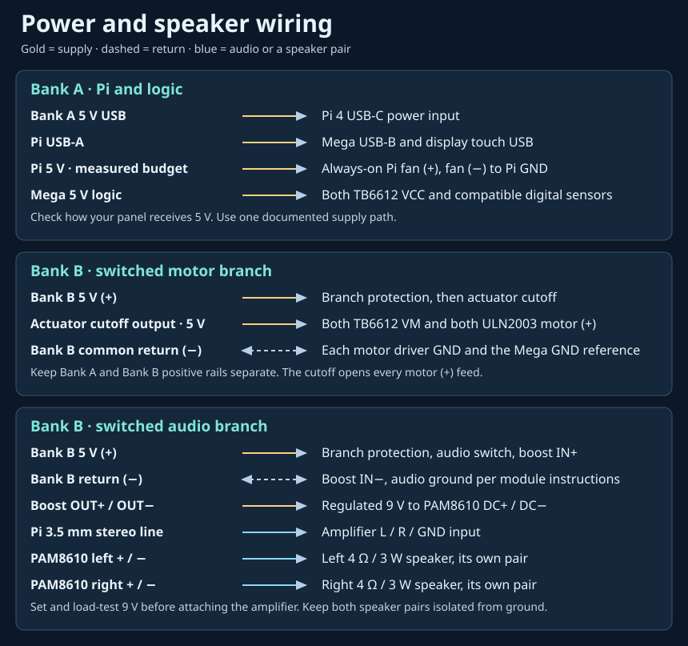

# EVE V3 - software setup, testing and calibration

Generated from tools/stage.py (`./eve stage guide`). On the Pi everything lives in `~/eve3`. See [every connection](WIRING.md) and [build progress](PROGRESS.md).

## Check the wiring before powering on

Keep both banks disconnected while wiring. Follow the [Mega, Pi and power diagrams](WIRING.md#wiring-diagrams) and their matching connection tables.



Two PuTTY windows: **PuTTY 1** runs EVE (`./eve run`, Ctrl+C stops safely), **PuTTY 2** is for commands.
Replace `PI_IP` with the Pi's address. For each stage: run the commands, then `./eve stage Mxx`, do the test yourself, then `./eve stage Mxx done`.

Rules: stages in order, never skip. The Bank B actuator branch stays OFF until M07 except for attended electrical measurements at M03. The audio branch may be powered separately for speaker tests. A software PASS is not a physical test. The Bank B switch is the physical motor-power stop; software stop needs a working runtime/link.

## Before M00: choose an installation route

Use a separate checkout if an older robot installation already exists. Keep the
motor supply off. The installer first runs the clone check with temporary state
and simulated hardware. It verifies the packaged 90 original WAVs, the web
routes and authenticated home commands before installing any system packages.
A failure at this point means stop and check that you have the complete Git
checkout or ZIP. A passing check still requires the physical M01–M17 tests.

Target: Raspberry Pi 4, Raspberry Pi OS Desktop 64-bit Bookworm, Python 3.11, a
working desktop login, SSH/PuTTY access and internet. Complete the Before you begin
page first. PuTTY opens a terminal; the desktop must also be running on the Pi for the face.

Keep the Bank B actuator branch off. Substitute your real Pi username/IP and ZIP path.
Labels such as **PuTTY 1** identify the window; they are not shell commands.

### Route A — clone the repository on the Pi

**PuTTY 1**

```bash
sudo apt-get update && sudo apt-get install -y git
git clone https://github.com/Slicersword/EVE.git "$HOME/eve3"
cd "$HOME/eve3" || exit 1
bash scripts/setup_pi.sh
```

The clone refuses an occupied destination. Choose a fresh folder instead of
overwriting source or merging unknown files. The installer changes only required
system packages/settings, creates the virtual environment, and installs the AVR
toolchain; it does not upload firmware or start the robot.

Reconnect PuTTY once for the new groups to apply, then continue with M00.

### Route B — transfer GitHub's complete ZIP

Download **Code → Download ZIP** from the repository and save it as `EVE-main.zip`.
This is an alternative to Route A. Transfer it using WinSCP/SFTP, or PSCP installed
with PuTTY. For PSCP, replace the Windows path, username and address below.

**Windows PowerShell**

```powershell
pscp "C:\path\to\EVE-main.zip" PI_USER@PI_IP:EVE-main.zip
```

**PuTTY 1**

```bash
sudo apt-get update && sudo apt-get install -y unzip
```

```bash
bash <<'EVE_INSTALL'
set -euo pipefail
[ ! -e "$HOME/eve3" ] || { echo "STOP: choose a fresh destination; ~/eve3 already exists."; exit 1; }
stage_dir=$(mktemp -d)
trap 'rm -rf "$stage_dir"' EXIT
unzip -q "$HOME/EVE-main.zip" -d "$stage_dir"
[ -f "$stage_dir/EVE-main/eve3/runtime.py" ] || { echo "STOP: expected the complete GitHub ZIP."; exit 1; }
mv "$stage_dir/EVE-main" "$HOME/eve3"
cd "$HOME/eve3"
chmod +x eve scripts/*.sh tools/*.py
bash scripts/setup_pi.sh
EVE_INSTALL
```

Reconnect PuTTY, then continue with M00. ZIP installations have no Git history and
cannot use the automatic fast-forward update helper. Keep a private backup and
replace with a fresh full ZIP when updating.

### Select the Mega port before uploading (M02)

Leave motor power off. Identify the actual device; genuine Mega boards may use
`ttyACM`, while USB-serial clones may use `ttyUSB`. Prefer a persistent by-id path.

```bash
ls -l /dev/serial/by-id/ /dev/ttyUSB* /dev/ttyACM* 2>/dev/null || true
arduino-cli board list
```

If arduino-cli is not in PATH, use `"$HOME/bin/arduino-cli" board list`.
Set the actual device path, replacing the example:

```bash
./eve cfg set serial.port /dev/ttyUSB0
```

The flasher and runtime both honor this setting. Reconnect the same Mega USB cable
and verify permissions before repeating an upload.

### How the virtual environment works

The installer creates `.venv` with system-site-packages, so apt-installed Pi drivers
remain available. The EVE launcher selects `.venv/bin/python` automatically; you
do not need to activate it in each PuTTY window. System package/firmware tooling
uses the shell. Run the robot as your normal user, not root.

The installer targets Pi 4 / arm64 / Bookworm and stops early on another platform.
Camera/display packages are installed for the complete reference build even if
those features will be enabled at a later stage. Package installation requires
internet; host tests and the generated documentation work without hardware.

<a id="m00"></a>

## M00 - Foundation: fresh install and self-tests

Choose ONE installation route in the installation section above. Use a fresh ~/eve3 folder; keep Bank B off. After the chosen route finishes, reconnect PuTTY once to apply the new groups.

**PuTTY 1**

```bash
cd "$HOME/eve3" || exit 1
./eve doctor
./eve stage M00
```

Automatic checks (`./eve stage M00`): config loads and is valid; virtual environment exists; all software self-tests pass (takes ~30 s).

**Your test:** Bank B (motor power) stays OFF for M00-M02. `./eve doctor` shows PASS for config, venv and Python. The source is in a fresh folder; no hardware commissioning flags have been set.

Then: `./eve stage M00 done`

<a id="m01"></a>

## M01 - Face on the screen

Needs: M00 done.

[Try the eyes and expressions in your browser](UI_PREVIEW.md#touchscreen-face).

**PuTTY 1**

```bash
cd "$HOME/eve3" || exit 1
./eve run
```

**PuTTY 2**

```bash
cd "$HOME/eve3" || exit 1
./eve face
./eve ctl expression name=happy
sleep 6
./eve ctl say "Hello"
```

Automatic checks (`./eve stage M01`): EVE is running and answers.

**Your test:** The 7-inch screen shows EVE's teal Lumen eyes in full screen. The eyes blink. `expression name=happy` shows narrower eyes and a smile for 5 s.

Then: `./eve stage M01 done`

<a id="m02"></a>

## M02 - Mega link + new firmware

Needs: M01 done.

Stop EVE with Ctrl+C in PuTTY 1. Keep Bank B off. Flashing is performed FROM THE PI over its USB cable to the Mega; no separate Windows Arduino upload is needed.

**PuTTY 1**

```bash
cd "$HOME/eve3" || exit 1
./eve flash && ./eve run
```

**PuTTY 2**

```bash
cd "$HOME/eve3" || exit 1
./eve status
```

Automatic checks (`./eve stage M02`): Mega connected; Mega online (heartbeat + telemetry); firmware matches this config; firmware has wheels and head disabled.

**Your test:** PuTTY 1 prints `Mega connected. Firmware id ... matches.` `./eve status` shows Mega online and `Cliff raw` with three 0/1 numbers. Pull the Mega USB plug: within 1 s status says OFFLINE; plug in: it comes back by itself.

Then: `./eve stage M02 done`

<a id="m03"></a>

## M03 - Power: two USB banks measured

Needs: M02 done.

**PuTTY 2**

```bash
vcgencmd get_throttled
vcgencmd measure_temp
```

Carry out the power and current measurements described in Your test BEFORE confirming any flag. Switch Bank B on only for these attended electrical measurements, then off again. The firmware still has both actuators disabled.

**PuTTY 2**

```bash
./eve cfg confirm power_a_verified
./eve cfg confirm power_b_verified
./eve cfg confirm motor_current_verified
```

Stop EVE with Ctrl+C in PuTTY 1, then restart to load your confirmations.

**PuTTY 1**

```bash
./eve run
```

**PuTTY 2**

```bash
./eve ctl session_start minutes=1
./eve status
```

Automatic checks (`./eve stage M03`): Pi supply flags readable and zero; Bank A confirmed by you; Bank B confirmed by you; motor current confirmed by you.

**Your test:** 1) Bank A alone powers Pi + screen + fan for 10 min with the face running: `vcgencmd get_throttled` stays `throttled=0x0`. 2) Bank B: with a multimeter check 5 V polarity at the motor-driver and head-driver power pins, that the switch cuts it, and that Bank B GND is joined to Mega/Pi GND. 3) Bank B does not switch itself off with all motor boards connected and idle. 4) Independently measure/verify the combined motor, head and boost-converter input/audio load against Bank B and driver/wiring ratings using a controlled electrical test with the chassis secured. Idle voltage alone is not a current test. If load/current verification is unavailable, leave motor_current_verified false and stop. Only then confirm the three flags. After restart `session_start` answers OK.

Then: `./eve stage M03 done`

<a id="m04"></a>

## M04 - Sensors: 3 distance + tilt + 3 cliff

Needs: M03 done.

Stop EVE with Ctrl+C in PuTTY 1. Keep Bank B off. Fix wiring until diagnostics report all four I2C devices. Releasing XSHUT changes bus addresses; only one process may own the sensors.

**PuTTY 1**

```bash
./eve i2c
```

After all four devices answer, start EVE.

**PuTTY 1**

```bash
./eve run
```

**PuTTY 2**

```bash
./eve status
```

Keep actuator power disconnected. Securely support the robot; never put it at an uncontrolled edge. Capture floor readings with all three cliff sensors over the normal floor.

**PuTTY 2**

```bash
./eve cliff floor
```

While securely holding/supporting the robot, expose all three cliff sensors to a drop/no floor and capture edge readings. Each sensor must give steady values and flip between floor and edge.

**PuTTY 2**

```bash
./eve cliff edge
./eve cliff apply
```

Stop EVE with Ctrl+C in PuTTY 1. Keep Bank B off; reflash the changed cliff calibration.

**PuTTY 1**

```bash
./eve flash && ./eve run
```

Automatic checks (`./eve stage M04`): distance sensors all give numbers; tilt sensor gives a number; robot standing level (tilt under 10 degrees); sensor data is fresh; cliff sensors calibrated; no cliff seen while standing on the floor.

**Your test:** `./eve status`: Distance shows three numbers 30-1000 that change when you move your hand in front of each sensor (order: front-left, front-right, rear). Tilt is near 0 on the floor and rises when you tip the robot. Cliff raw flips for each sensor when you lift that corner over an edge.

Then: `./eve stage M04 done`

<a id="m05"></a>

## M05 - Safety: it must refuse when anything is wrong

Needs: M04 done.

**PuTTY 2**

```bash
./eve ctl session_start minutes=5
./eve ctl clear
./eve status
watch -n 0.5 ./eve status
```

Ctrl+C stops watch. Perform each refusal test described below, then clear only after fixing its cause.

Automatic checks (`./eve stage M05`): wheels are blocked (nothing is commissioned to move yet); a reason is always given.

**Your test:** `Wheels:` stays blocked (nothing is commissioned to move yet) - that is correct. Watch the line `Sensors say:`. It must read `all clear` when the robot stands free on the floor, and change within half a second to: (a) `obstacle` with a hand 10 cm in front; (b) `cliff` when a corner is lifted over an edge (Mega latched=True); (c) `tilt` when tipped past ~30 degrees; (d) `...stale or missing` when the Mega USB is pulled (and Mega OFFLINE). (e) `./eve estop` shows LATCHED: emergency stop. After each, `./eve ctl clear` succeeds only when the cause is gone.

Then: `./eve stage M05 done`

<a id="m06"></a>

## M06 - Cooling (physical check)

Needs: M05 done.

**PuTTY 2**

```bash
vcgencmd measure_temp
```

Automatic checks (`./eve stage M06`): Pi temperature below 75 C.

**Your test:** The Pi fan spins whenever the Pi is on. After 15 min with the face running the temperature stays under 70 C. Any optional charger-side fan follows its separately reviewed supply arrangement. No software controls the fans.

Then: `./eve stage M06 done`

<a id="m07"></a>

## M07 - Wheels (lifted first)

Needs: M06 done.

**PuTTY 2**

```bash
./eve cfg set firmware.drive_enabled true
./eve cfg confirm contained_ground_area
```

Stop EVE with Ctrl+C in PuTTY 1. Bank B must be off while flashing.

**PuTTY 1**

```bash
./eve flash && ./eve run
```

Use a stable support with all four wheels free AND all cliff sensors viewing a safe floor target within their calibrated range. If that arrangement is not possible, stop and improve the support. Do not bypass a cliff check. Switch Bank B on; keep your hand at its physical switch.

**PuTTY 2**

```bash
./eve ctl session_start minutes=10
./eve ctl clear
./eve ctl drive_test left=60 right=60 wheels_lifted=true
```

Observe the first test and wait for all wheels to stop. Then try the gentle arc.

**PuTTY 2**

```bash
./eve ctl drive_test left=40 right=70 wheels_lifted=true
```

Do all stopping/direction tests below BEFORE confirming drive. Default max duration is one second in drive_test.

**PuTTY 2**

```bash
./eve cfg confirm drive_verified
```

Stop EVE with Ctrl+C and restart to load the flag. For the floor test, place the robot in the contained area, start a new attended session, then clear.

**PuTTY 1**

```bash
./eve run
```

**PuTTY 2**

```bash
./eve ctl session_start minutes=5
./eve ctl clear
./eve ctl drive left=100 right=100 seconds=1
```

Automatic checks (`./eve stage M07`): firmware.drive_enabled is on; safe test area confirmed; firmware matches; drive confirmed by you (after the test below).

**Your test:** Each drive_test turns all four wheels FORWARD for 1 second and stops by itself. If a wheel turns backward, switch everything off and swap that motor's two wires. During a test: `./eve estop` stops at once; covering a front distance sensor with your hand stops it; putting a finger under a cliff sensor is NOT a test - instead lift the robot so a cliff sensor sees no floor: it stops and latches. Reverse and pivot are refused. Only after that: confirm drive_verified, then try `./eve ctl drive left=100 right=100 seconds=1` on the floor in the closed area.

Then: `./eve stage M07 done`

<a id="m08"></a>

## M08 - Head pan / tilt

Needs: M07 done.

**PuTTY 2**

```bash
./eve cfg set firmware.head_enabled true
```

Stop EVE with Ctrl+C in PuTTY 1. Bank B off during upload. With motor power off, carefully align the head centre marks without forcing the gearbox.

**PuTTY 1**

```bash
./eve flash && ./eve run
```

Switch Bank B on with all sensors safe and the wheels stationary.

**PuTTY 2**

```bash
./eve ctl session_start minutes=10
./eve ctl clear
./eve ctl head_home confirm=true
```

Check that the head reports homed in status before jogging.

**PuTTY 2**

```bash
./eve ctl head_jog pan=8 confirm=true
```

Wait for each jog to finish, inspect cable clearance, then repeat as required. Use pan=-8, tilt=8 or tilt=-8 for the other directions. Note safe position values. If limits need reducing, use the optional settings section; stop, reflash and restart before continuing. Never increase the shipped limits without physical validation.

**PuTTY 2**

```bash
./eve cfg set head.soft_limits_verified true
./eve cfg confirm head_verified
```

Stop EVE with Ctrl+C and restart to load the confirmations. Reflash first if you changed pan/tilt limits. Start a new session, clear, and set manual home again after every restart/reflash that resets the Mega.

**PuTTY 1**

```bash
./eve run
```

**PuTTY 2**

```bash
./eve ctl session_start minutes=10
./eve ctl clear
./eve ctl head_home confirm=true
```

Check that the head reports homed in status before trying a look.

**PuTTY 2**

```bash
./eve ctl head_look direction=left
```

Observe the left look and wait for it to finish before returning to centre.

**PuTTY 2**

```bash
./eve ctl head_look direction=center
```

Automatic checks (`./eve stage M08`): firmware.head_enabled is on; firmware matches; head limits confirmed; head confirmed by you.

**Your test:** Each jog moves the head a tiny step in the expected direction (if pan or tilt goes the wrong way note it; camera.tracking_pan_sign / tracking_tilt_sign affect look/tracking only, not manual jog direction). Jog step by step to each side and stop BEFORE anything touches or a cable pulls; note the pan/tilt numbers from `./eve status` and set the limits a little inside them. After confirming: `./eve ctl head_look direction=left` and `direction=center` move smoothly.

Then: `./eve stage M08 done`

<a id="m09"></a>

## M09 - Touch pads

Needs: M08 done.

**PuTTY 2**

```bash
watch -n 0.5 ./eve status
```

Automatic checks (`./eve stage M09`): touch pads started.

**Your test:** Pat the head pad: the face turns pink/happy for 3 s. Tap the back pad: listening face. Hold the back pad 1 second: EMERGENCY STOP appears in PuTTY 1 and status shows latched.

Then: `./eve stage M09 done`

<a id="m10"></a>

## M10 - Camera (local only)

Needs: M09 done.

**PuTTY 2**

```bash
./eve cfg set camera.enabled true
```

Stop EVE with Ctrl+C and restart.

**PuTTY 1**

```bash
./eve run
```

**PuTTY 2**

```bash
./eve status
```

Head tracking is optional; see the optional settings section after completing the camera test.

Automatic checks (`./eve stage M10`): camera switched on in config; camera running.

**Your test:** The LED next to the camera is ON whenever the camera runs and OFF when EVE stops. When you stand in front, the eyes on the screen follow you. Closing the shutter: eyes stop following. No picture file appears anywhere (`find ~/eve3/data -type f` shows only eve.db, token, lock, json). With tracking on (in a session, head homed) the head turns slowly toward your face.

Then: `./eve stage M10 done`

<a id="m11"></a>

## M11 - Memory

Needs: M10 done.

**PuTTY 2**

```bash
./eve ctl chat "remember that the EVE test note is for setup"
```

Restart EVE once, then check that the test note persists.

**PuTTY 2**

```bash
./eve ctl chat "what do you remember"
./eve ctl notes
```

Replace NOTE_ID below with the numeric ID of the test note in the list.

**PuTTY 2**

```bash
./eve ctl note_forget id=NOTE_ID
./eve ctl notes
```

Automatic checks (`./eve stage M11`): memory on.

**Your test:** She repeats the test note back after a restart. Record that note's ID, remove it, and verify just that ID is gone.

Then: `./eve stage M11 done`

<a id="m12"></a>

## M12 - Brain: offline answers (+ optional on-Pi model)

Needs: M11 done.

**PuTTY 2**

```bash
./eve ctl chat "who are you"
./eve ctl chat "किती वाजले"
./eve ctl chat "एक चुटकुला सुनाओ"
./eve ctl chat "tell me a story"
```

Optional local models need a separately installed on-Pi llama-server and model. They are not bundled or required; keep cloud AI off.

Automatic checks (`./eve stage M12`): answers a question.

**Your test:** She answers in the language you used (English, Hindi, Marathi). Unknown questions get an honest "I did not understand" unless the optional local model is running. Cloud AI stays off.

Then: `./eve stage M12 done`

<a id="m13"></a>

## M13 - Voice: speaking and hearing

Needs: M12 done.

**PuTTY 2**

```bash
./eve ctl say "Hello, I am EVE"
./eve ctl say "नमस्ते" lang=hi
./eve ctl say "नमस्कार" lang=mr
```

The PAM8610 uses the verified regulated 9 V boost branch, with a measured output limit for the 3 W speakers. Stop EVE with Ctrl+C in PuTTY 1. Complete the INMP441 I2S setup in the reference section below, including reboot and both-channel tests. The first voice install requires internet and downloads whisper.cpp and its model.

**PuTTY 1**

```bash
bash scripts/install_voice.sh && ./eve mic
```

Apply the threshold command printed by the microphone tool. Change the capture device if the default is wrong; see optional settings.

**PuTTY 2**

```bash
./eve cfg set voice.capture_enabled true
```

**PuTTY 1**

```bash
./eve run
```

Automatic checks (`./eve stage M13`): speaker has no error; whisper installed; microphone switched on in config; microphone listening.

**Your test:** You hear all three sentences clearly from the speakers (Bank B audio branch on). Then say "EVE, what time is it?" - she answers within a few seconds. Say "EVE" ... "tell me a joke". Say "stop" without her name: she says Stopped. While she talks she does not answer herself.

Then: `./eve stage M13 done`

<a id="m14"></a>

## M14 - Behaviour

Needs: M13 done.

**PuTTY 2**

```bash
watch -n 0.5 ./eve status
```

Automatic checks (`./eve stage M14`): behaviour on.

**Your test:** Leave the room for a minute and walk back in: PIR shows True and she greets once (not again for 10 minutes; silent between 22:00 and 07:00). A hand closer than 30 cm gives a surprised face. After 15 quiet minutes the face goes sleepy; a touch or her name wakes her.

Then: `./eve stage M14 done`

<a id="m15"></a>

## M15 - Reminders

Needs: M14 done.

**PuTTY 2**

```bash
./eve ctl chat "remind me in 1 minute to drink water"
./eve ctl reminders
```

Automatic checks (`./eve stage M15`): can list reminders.

**Your test:** After one minute she says the reminder aloud once. It stays marked Announced in Home until you choose Done. A reminder set before a restart still fires after it. If audio fails, it stays due.

Then: `./eve stage M15 done`

<a id="m16"></a>

## M16 - Extras: sleep, phone control page

Needs: M15 done.

[See the control panel with sample readings](UI_PREVIEW.md#control-panel).

**PuTTY 2**

```bash
./eve ctl chat "go to sleep"
sleep 5
./eve ctl chat "wake up"
```

Phone control on the trusted home network is optional; see optional settings. Keep the default loopback address if you only need the Pi screen and PuTTY.

Automatic checks (`./eve stage M16`): web tools are off unless you chose otherwise.

**Your test:** Sleep gives the sleepy face, ends the attended session and turns the camera indicator off if the camera was active. Wake brings her back. If you enabled phone control: it shows live status, the red EMERGENCY STOP works, and a wrong token shows no data. Leave network.host at 127.0.0.1 if you do not need phone control.

Then: `./eve stage M16 done`

<a id="m17"></a>

## M17 - Whole robot + start at boot

Needs: M16 done.

**PuTTY 2**

```bash
./eve ctl session_start minutes=30
./eve ctl clear
```

Run the 30-minute attended acceptance test below. Only after it passes, stop EVE with Ctrl+C in PuTTY 1 and install autostart. Bank B off for the reboot.

**PuTTY 1**

```bash
bash scripts/install_service.sh
```

**PuTTY 2**

```bash
sudo reboot
```

Reconnect PuTTY, verify the face and runtime start, then run ./eve stage M17. No motion is permitted until a fresh attended session and clear.

Automatic checks (`./eve stage M17`): everything commissioned; firmware matches; all sensors healthy.

**Your test:** During the 30 minutes: no under-voltage (`Pi supply flags 0x0`), STOP works by voice, back-pad hold and `./eve estop`; she never drives after the session ends. After the reboot the face and EVE come up by themselves and nothing moves until you start a session and clear.

Then: `./eve stage M17 done`

## INMP441 I2S setup at M13

Complete the [two-microphone wiring](WIRING.md#microphone-amplifier-and-speakers)
with power off. Mic 1 L/R is GND; Mic 2 L/R is 3.3 V. Both SD signals share BCM20;
BCM18 is SCK and BCM19 is WS. Keep Bank B actuator power off and stop EVE/service
before changing audio configuration. This profile targets Pi 4 Bookworm only.

The INMP441 has no I2C control address. It needs an ALSA I2S capture card before
`arecord` or the robot can hear it. The supplied capture-only Device Tree overlay
uses the kernel's passive ADAU7002 I2S endpoint; it does not require an ADAU7002 chip
or a downloaded third-party kernel driver. It creates a separate EVEINMP441 card
so the Pi analogue output can remain available for the PAM8610. This is a software
profile to be accepted on the actual hardware, not a claim of a completed microphone test.

**PuTTY 1 — EVE stopped**

```bash
cd "$HOME/eve3" || exit 1
sudo apt-get install -y device-tree-compiler
sudo python3 tools/setup_i2s_mic.py --boot
sudo reboot
```

The helper backs up boot configuration, compiles/installs eve-inmp441.dtbo and adds
one marked block under an all-model section. It refuses known conflicting I2S audio
overlays instead of replacing another device. If it stops, review the named overlay;
do not stack multiple audio devices on the same I2S pins. It does not start recording,
enable the microphone, change readiness flags or set playback defaults.

Reconnect PuTTY after reboot. As your normal Pi user, **without sudo**:

```bash
cd "$HOME/eve3" || exit 1
python3 tools/setup_i2s_mic.py --user-audio
arecord -l
arecord -L
```

Look for EVEINMP441 in the hardware list and eve_mic in the named device list. The
helper preserves the rest of ~/.asoundrc and adds only the named capture PCM, with
a backup if that file already exists. Its hardware stream is fixed to S32_LE,
48 kHz, 2 channels: 64 bit clocks per stereo frame. The plug layer averages the
two slots and converts to EVE's S16_LE, 16 kHz mono format. A plain hw device at
16-bit mono does not satisfy the microphone's clock/frame requirements.

First prove a native stereo stream opens for three seconds, discarding the audio:

```bash
arecord -D hw:CARD=EVEINMP441,DEV=0 -f S32_LE -r 48000 -c 2 -t raw -d 3 > /dev/null
./eve cfg set voice.capture_device eve_mic
./eve mic
```

No sample file is created by these tests. Follow the quiet and speech prompts;
record the suggested threshold. Repeat the speech test speaking close to each mic
in turn so a working second mic cannot conceal a disconnected first mic. If needed,
a stereo recording can be inspected privately using the temporary-RAM route below.
Do not enable voice capture until both microphones respond and speech is clearly
above quiet noise.

For a short optional **private audio test**, with the runtime stopped and the
accepted amplifier at low volume, the following records in /dev/shm and removes
its own clip on exit. This is a deliberate recording test, not a permanent log:

```bash
bash <<'EVE_MIC_TEST'
set -euo pipefail
clip=$(mktemp /dev/shm/eve-mic-check-XXXXXX.wav)
trap 'rm -f "$clip"' EXIT
arecord -D hw:CARD=EVEINMP441,DEV=0 -f S32_LE -r 48000 -c 2 -d 5 "$clip"
aplay "$clip"
EVE_MIC_TEST
```

Speak near Mic 1 for the first half, then Mic 2. Their opposite channel slots should
be audible in the expected left/right outputs. Do not run this playback through an
unverified amplifier or assume a mixed mono result proves both mics. If an input is
silent, power down and inspect L/R, SD, 3.3 V, ground and slot conflict first.

Select the Pi desktop's **Headphones / analogue** playback output, not HDMI. From
an SSH session in the same logged-in user's desktop environment, `pactl list short
sinks` lists outputs and `pactl set-default-sink ACTUAL_SINK_NAME` selects the actual
name; do not paste that placeholder literally. If pactl cannot reach a sound server,
use desktop audio settings or diagnose the user's audio session. Verify real sound
with the M13 speech commands and the amplifier's output limit before acceptance.

If boot audio breaks, keep actuator power off, remove only the marked EVE INMP441
block from /boot/firmware/config.txt using an editor, and reboot. Restore its printed
backup instead only if you have made no other settings changes since. Likewise
remove only the marked user-audio block, or review its backup, to undo ~/.asoundrc.
The generated overlay can remain unused; never delete unrelated audio settings.

## Optional settings and daily operation

Use these after the relevant M-stage has passed. Any setting change needs a runtime restart; settings
compiled into the Mega also need a fresh flash while Bank B is off. EVE prints a reflash reminder.

### Owner command reference (PuTTY 2)

```bash
cd "$HOME/eve3" || exit 1
./eve stage
./eve status
./eve status full
./eve doctor
./eve cfg show
./eve ctl token
./eve ctl stop
./eve estop
./eve ctl session_end
```

The first commands inspect state. Normal stop ends motion; estop additionally latches. A clear request
never overrides an unsafe reading. Use the physical Bank B switch if software cannot stop the robot.

### Optional camera tracking (after M08 and M10)

```bash
./eve cfg set camera.allow_tracking true
```

Restart EVE, start a new session, clear and manually home before expecting head tracking.
For reversed look/tracking orientation, adjust the relevant sign after observing the real axis:

```bash
./eve cfg set camera.tracking_pan_sign -1
```

This does not change manual head_jog signs. Disable tracking again if it moves away from the face.

### Optional Mega upload from a separate computer (M02)

The Pi flasher is the standard route. If you upload using another computer, keep
the actuator cutoff off and stop the EVE process on the Pi first. Generate the
header on the Pi so the sketch matches its current configuration.

```bash
.venv/bin/python tools/gen_header.py
```

Use WinSCP or SFTP to copy the entire `firmware/eve_controller` folder to the
other computer. Copy only the sketch folder, with `eve_controller.ino` and
`eve_config.h` together. Disconnect the Mega from the Pi, then plug it into the
other computer with the USB data cable. In Arduino IDE, install Arduino AVR
Boards 1.8.6, select Arduino Mega or Mega 2560 with the ATmega2560 processor,
select the Mega's actual port, and verify and upload the sketch.

Disconnect the USB cable from the other computer and reconnect it to the Pi.
Run `./eve run` and confirm `./eve status` shows online and a matching firmware
fingerprint. Repeat this process after any later stage changes a firmware
setting. See [Arduino Mega 2560 documentation](https://docs.arduino.cc/hardware/mega-2560/).

### Optional IMU orientation / address (M04)

Only use these after identifying an inverted board or an AD0-high address. They are alternatives to
correcting the physical orientation/address; do not apply both merely because tilt is missing.

```bash
./eve cfg set sensors.imu_inverted true
```

```bash
./eve cfg set sensors.imu_address 105
```

Restart EVE, then repeat level/tilt tests.

### Head limits (M08)

Read the safe pan/tilt positions reached by small observed jogs. The following values are the shipped
bounds, NOT measured limits for your robot. Replace them with your measured smaller safe bounds where
necessary; negative minimums and positive maximums are required.

```bash
./eve cfg set head.pan_min_steps -650
./eve cfg set head.pan_max_steps 650
./eve cfg set head.tilt_min_steps -260
./eve cfg set head.tilt_max_steps 260
```

Stop EVE, turn Bank B off, flash, restart, then repeat home/jog acceptance before confirming soft limits.

### Audio devices (M13)

With EVE stopped:

```bash
arecord -l
aplay -l
./eve mic
```

If the microphone is not the ALSA default, choose the actual capture device shown on your Pi. This is
an example only; substitute your identified card/device, then recalibrate the threshold.

```bash
./eve cfg set voice.capture_device plughw:1,0
```

### Optional echo cancellation (M13)

Accept the standard M13 tests first. This optional path listens while EVE speaks
through a paired local WebRTC echo-cancel source and sink. It needs a running Pi
desktop audio session and a physical acoustic test at the intended speaker
volume. Keep the actuator cutoff off during this setup.

**PuTTY 1, with EVE stopped**

```bash
sudo apt-get install -y pulseaudio-utils
EVE_PULSE="unix:/run/user/$(id -u)/pulse/native"
pactl --server="$EVE_PULSE" info
pactl --server="$EVE_PULSE" list short sources
pactl --server="$EVE_PULSE" list short sinks
```

Use the source and sink names in the second column. Select the actual INMP441
capture source and the analogue headphone output feeding the PAM8610. A source
ending in `.monitor` records playback. If the INMP441 is visible only to ALSA
or the echo module is unavailable, continue with the standard M13 route.

```bash
read -r -p "INMP441 desktop source name: " EVE_MIC_SOURCE
read -r -p "Analogue headphone sink name: " EVE_HEADPHONE_SINK
pactl --server="$EVE_PULSE" load-module module-echo-cancel aec_method=webrtc \
  source_master="$EVE_MIC_SOURCE" sink_master="$EVE_HEADPHONE_SINK" \
  source_name=eve_echo_capture sink_name=eve_echo_playback
pactl --server="$EVE_PULSE" list short sources
pactl --server="$EVE_PULSE" list short sinks
```

Record the module number printed on success. Continue only when both named routes
appear. The temporary module must be loaded again after a reboot or restart of the
audio server. Test in a foreground run before considering it for daily use.

```bash
./eve cfg set voice.echo_cancel_enabled true
./eve run
```

In PuTTY 2 check `./eve status full` for the microphone and voice mode. Use
`./eve ctl say "I am checking my speaker and microphone. The local test is now running."`
and speak “EVE, what time is it?” during playback. Repeat with multiple phrases,
distances and volumes. Then play the same speech again with nobody talking.
Acceptance requires the person's speech to be recognized without self-triggered
replies, oscillation or feedback. Software checks exercise routing, and the
physical test establishes acoustic performance.

Wheel and head requests from the microphone are refused in this mode. Use the
authenticated controls for motion. Live face cues and Home music still pause
with capture enabled because they are browser audio. A missing paired route
reports a voice error. If the route or acoustic test fails, stop EVE, turn off
echo mode, and restart:

```bash
./eve cfg set voice.echo_cancel_enabled false
./eve run
```

See the [PipeWire echo-cancel module options](https://docs.pipewire.org/page_pulse_module_echo_cancel.html).

### Optional local LLM (M12)

A separately installed on-Pi model server must provide the loopback chat endpoint in config.
No model or server is bundled; 2 GB Pi performance has not been validated. Basic offline replies need neither.
After the model server is running and tested locally:

```bash
./eve cfg set ai.local_llm.enabled true
```

Restart EVE. Disable the model if its resource use harms robot operation. Cloud
starts off and its optional adapter accepts fixed public questions only.

### Optional phone control (M16)

Only on a trusted home network:

```bash
./eve cfg set network.host 0.0.0.0
```

Restart EVE and read its fresh token:

```bash
./eve ctl token
```

On your phone open http://PI_IP:8765/control and paste that token. Wrong token must not expose status
or permit a command. The HTML control shell itself is public; data and commands are protected.
This HTTP mode is not intended for Internet access. To return to Pi-only access:

```bash
./eve cfg set network.host 127.0.0.1
```

Restart EVE again.

### View control from Windows without RDP

Keep EVE bound to 127.0.0.1. In a separate **Windows PowerShell** session:

```powershell
ssh -N -L 8765:127.0.0.1:8765 PI_USER@PI_IP
```

Keep that session open. In the Windows browser visit http://127.0.0.1:8765/control, using the token read
from PuTTY. This forwards the Pi web UI; it does not mirror the Pi desktop. Continue using the kiosk
launcher to put the face on the robot's own display.

### Service management (after M17)

```bash
systemctl --user status eve3.service
journalctl --user -u eve3.service -n 50 --no-pager
systemctl --user stop eve3.service
```

Stop the service before foreground runs, I2C diagnosis or flashing. To restart after maintenance:

```bash
systemctl --user start eve3.service
```

To remove autostart:

```bash
bash scripts/install_service.sh --remove
```

### Update and keep the previous two backups

For a Git install, with motor power off and EVE/service stopped:

```bash
bash scripts/update_repo.sh
```

The helper refuses local tracked edits or a non-main branch, backs up source and owner data privately,
fetches main, uses a fast-forward merge, then runs checks. It does not install changed dependencies,
reflash or start EVE. Review CHANGELOG after updating. It retains the last two successful update snapshots
in ~/eve_backups. If checks fail it keeps the backup and stops for review; it does not silently reset files.
ZIP installs require their own saved copy of the current source plus config/local.json and data before
replacement; do not overlay unknown local edits. Pi-side virtual environments and
downloaded models are not included in these source/state backups.

To preview a backup without restoring private state:

```bash
ls -lt "$HOME/eve_backups"
```

Choose a known good backup, extract into a separate recovery directory, inspect it and recover with the
runtime stopped. Reflash any restored compiled configuration before actuator use. Do not publish backups.

## Developer verification

On Linux (Python 3.10+, g++ for firmware-harness tests), from this repository root:

```bash
python3 -m unittest discover -s tests -t .
python3 tools/check_repo.py
python3 -m compileall -q eve3 tools tests
```

After editing recipes/stages:

```bash
python3 tools/stage.py guide > docs/SETUP_GUIDE.md
python3 tools/build_source_index.py
```

After editing compiled defaults:

```bash
python3 tools/gen_header.py
```

Target AVR compilation (no device upload):

```bash
arduino-cli core update-index
arduino-cli core install arduino:avr
arduino-cli compile --fqbn arduino:avr:mega firmware/eve_controller
```

CI repeats the host verification and separately compiles the sketch for Mega. Host firmware tests may
skip when g++ is absent; install g++ before treating the full suite as verified.

### Simulation on a Linux computer

Simulation disables real serial, I2C, GPIO touch, camera, microphone, speaker and external AI requests.
It uses fake Mega/sensor objects and separate data/sim state. All normal commissioning gates remain.
It is a software exercise, never a way to confirm a physical M-stage. To run in one terminal:

```bash
./eve sim
```

In another terminal, from the same source folder:

```bash
EVE_SIM=1 ./eve status
EVE_SIM=1 ./eve ctl chat "who are you"
```

Do not set physical readiness flags to make simulation move. The automated tests already exercise
commissioned fake configurations in temporary test state. Ctrl+C stops the simulation.


## Try the restored expressions and home activities

After M01 and the speaker check at M13, with wheel and head power off:

1. On the face, tap the eyes to reveal **Expression sounds**, expand the panel and
   choose **Enable sounds**. This starts muted on each new page load. **Natural**
   is the default policy. **Quiet** allows rare attention cues, and **Playful**
   allows additional reactions such as Proud Smile.
2. Open the loopback control page using the usual token. Choose **Show expression**
   to set the face for five seconds. For a direct sound-output check, open
   **Expression studio and sound preview** and play Happy or Proud Smile. Preview
   and live cues play on the device displaying the page. Keep live speech and the
   microphone off during studio previews.
3. In the control page, choose **EVE at home**. Start an activity and verify its
   language and controls. Save only a test story or recipe you choose, reload,
   and resume it. Try a short named timer. Select a local file for the music
   visualizer, with microphone capture disabled. The file stays in that browser.
4. Live cues yield to speech, microphone capture, quiet hours and a STOP latch.
   Try them with mic capture disabled. If there is an active safety latch, use
   the standalone preview for the speaker check while the robot is stationary.
   Never clear an unresolved motion fault to hear a sound.

For a hardware-free verification of a checkout, from the repository folder:

```bash
python3 tools/check_clone.py
```
