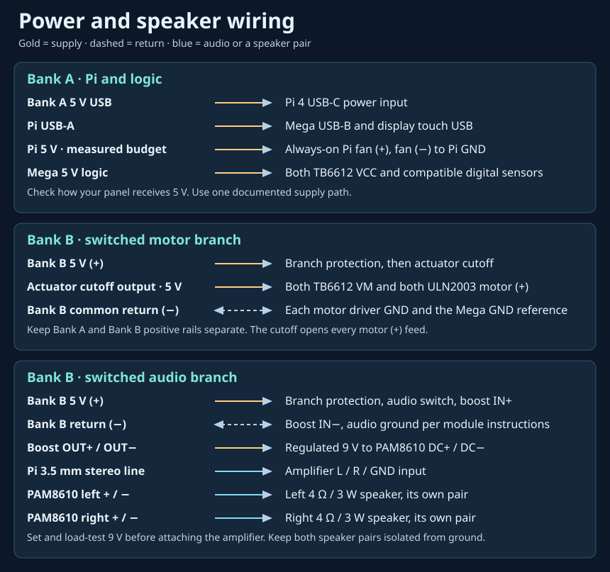
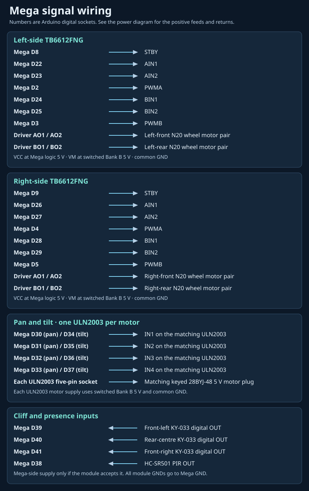
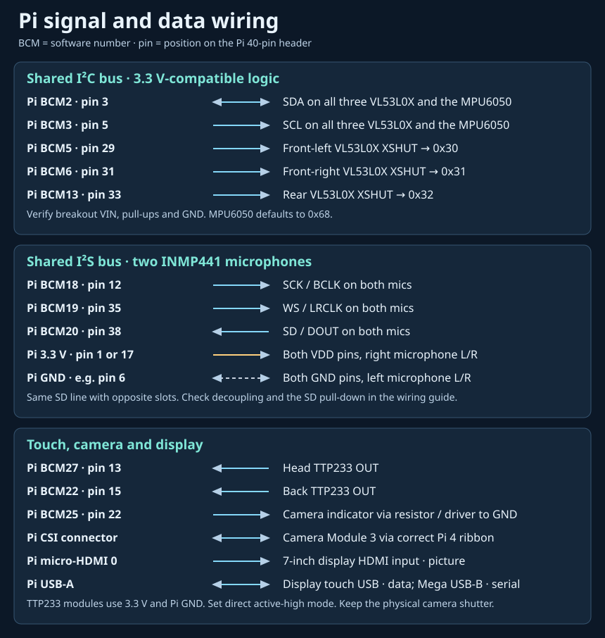

# Wire every EVE component

This page maps the listed build parts to the pins used by the shipped software.
Work with **both power banks disconnected**, finish one subsystem, label its leads,
then inspect it before connecting the next. Software installation and live diagnostic
commands are together in [Software setup](SETUP_GUIDE.md).

The main build uses **two regulated 5 V USB power banks**. The optional 20 A BMS,
lithium packs, charger and buck converters are outside this build's charging circuit.
INA219 is disabled and is not wired. The INMP441 microphones are I2S devices;
the distance and tilt sensors use a different bus, I2C.

## Wiring diagrams

Read the wire labels in the diagrams, then use the tables below to identify each
terminal on your particular board. The diagrams use the shipped pin assignments
and show connections by signal name. Open an image at full size to read small labels.

### Power and speakers

[Open power wiring at full size](assets/wiring-power.svg).

### Mega signals

[Open Mega wiring at full size](assets/wiring-mega.svg).

### Pi signals

[Open Pi wiring at full size](assets/wiring-pi.svg).

## Read the connection labels

| Label | Meaning | Example |
|---|---|---|
| BCM / GPIO | Pi software signal number | BCM5 is physical pin 29 |
| Physical pin | Position on the Pi 40-pin header | Physical pin 5 is BCM3 / SCL |
| Mega D | Number printed beside a Mega digital socket | D30 is not Pi BCM30 |
| VCC / VIN | Module supply input; actual rating depends on that board | Identify the breakout before supplying it |
| GND | Supply return and signal reference | Must be shared by communicating boards |
| OUT / D0 / DO | Digital signal | Use this on the cliff modules |
| A0 / AO | Analogue signal | Not used for cliff sensing in this firmware |
| VM | Wheel-driver motor supply | Separate from driver logic VCC |
| I2C SDA/SCL | Shared two-wire control bus | Three ToF boards plus MPU6050 |
| I2S SCK/WS/SD | Digital audio clock, frame and data | Two INMP441 microphones |

Use the Pi board's pin-1 mark and the [official header diagram](https://www.raspberrypi.com/documentation/computers/raspberry-pi.html#gpio).
Locate pins while looking down on the component side; a view from below is mirrored.
Wire by the board's printed **signal name**, not by cable colour or an online photo's
left-to-right order. Module sellers can reverse connector order without changing the name.

## Power distribution

| Branch | Connect to | Do not connect to | Required check |
|---|---|---|---|
| Bank A regulated 5 V | Pi USB-C; display and Pi cooling within the measured budget | Any Bank B positive output | Stable voltage at the Pi under all attached loads |
| Pi USB | Mega USB-B, display touch USB, optional USB storage | A second positive supply injected into Mega 5 V/VIN | Data-capable cables and total USB load |
| Bank B regulated 5 V | Protected switched actuator distribution | Pi 5 V / Bank A positive | Cutoff opens every wheel/head motor-positive branch |
| Actuator distribution | Both TB6612 VM pins and both ULN2003 motor-positive inputs | Pi signal GPIO, amplifier supply expecting a higher voltage | Combined starting/running current, cable drop and heating |
| Mega regulated logic 5 V | TB6612 VCC and compatible digital sensor modules | TB6612 VM as a substitute for an identified motor supply | Module and USB logic-current budget |
| Pi 3.3 V | Identified compatible sensor/touch boards and both INMP441 VDD | 5 V devices or large loads | Total 3.3 V load, correct module supply point |
| Common logic ground | Pi/Mega, both driver grounds, sensor and mic grounds, Bank B negative | Any amplifier speaker terminal | Motor returns go straight to the distribution return |
| PAM8610 supply | Bank B 5 V → separate audio switch → regulated 9 V boost → PAM8610 | Direct 5 V USB, Pi GPIO, wheel VM or ULN2003 5 V | Set/test boost output with amplifier disconnected first |

Keep positive outputs from the banks separate. Common ground does not mean common
positive. Make the Bank B ground connection before signal wiring, with all power off.
Do not use a thin sensor ground or the Pi–Mega USB shield as the motor return path.
Route each driver's high-current return to the Bank B distribution return; also provide
the logic reference connection to Mega GND.

Use switches, connectors, wire and branch protection rated for the actual load. Select
fuse/current limits to protect the weakest wire/connector and permit normal startup;
there is no universal fuse value without the measured motor and cable specifications.
USB cut leads require polarity identification and insulation. Do not assume that an
advertised combined power-bank rating is available from one USB socket.

Record each bank's printed output rating, port used, cable, measured idle voltage,
loaded voltage, peak/continuous current and auto-off behavior in the private build
worksheet. Pi 4's usual 5 V / 3 A supply guidance does not include an unlimited display,
SSD, Mega and accessory budget. A 5 V / 3 A bank may be insufficient for all of these.
Idle voltage alone does not prove load capacity. M03 stops the build until power is measured.

## Pi, display and storage

| From | To | Notes |
|---|---|---|
| Bank A USB regulated output | Pi 4 USB-C power input | Suitable cable, measured voltage under load; avoid loose adapters |
| Pi micro-HDMI port HDMI0, nearest USB-C | Display HDMI input | Use the listed micro-HDMI-to-HDMI lead |
| Pi USB-A | Display USB port labelled TOUCH / USB data | Touch data and sometimes board power; inspect the display manual |
| Verified 5 V supply | Display power input, **only if its manual requires it** | Some displays use separate USB power; prevent supply backfeeding |
| 64 GB+ microSD | Pi microSD slot, contacts oriented as the Pi guide shows | Write OS before assembly; insert/remove with power off |
| Optional USB SSD enclosure | Pi USB 3 socket with data-capable cable | Adds USB current; microSD boot remains a complete starting route |

The supplied display description does not identify its exact power socket or whether
its USB ports share a rail. Do not power two display inputs from different banks without
its schematic. Start with the manufacturer's HDMI/USB arrangement. Set landscape
1024×600 in the Pi desktop display settings; test touch in all four corners before kiosk use.
HDMI carries the image; USB carries touch. Neither is a replacement for the other.

## Mega USB and logic

Connect Pi USB-A to Mega USB-B using the listed data cable. This supplies logic power
and the serial connection. Do not run separate GPIO UART wires. Do not connect the
Mega's 5 V logic outputs to Pi inputs. The firmware communicates over USB at 115200 baud.

Leave Mega VIN, barrel jack and external 5 V injection unconnected in this arrangement.
A clone's power-selection circuit may differ: confirm that nothing can backfeed USB.
Use Mega **GND** for driver/sensor signal references. The Mega's I2C D20/D21 pins are
not the Pi's I2C bus and remain unused by these sensors.

## Wheel drivers and four motors

Use **two TB6612FNG boards**, one per side, with one N20 6 V / 100 RPM motor on each
channel. Label positions relative to the robot looking forward, not a person facing it.
The 5 V motor rail runs these 6 V motors below their nominal voltage; actual speed/torque
will differ from the rating. Measure startup/stall requirements and ensure the modules
can handle them. A model's size and RPM do not specify its stall current.

| TB6612 signal | Left-side board | Right-side board |
|---|---|---|
| VCC, logic | Mega 5 V | Mega 5 V |
| VM, motor supply | Switched Bank B 5 V | Switched Bank B 5 V |
| GND, all board ground terminals | Bank B return plus Mega signal GND | Bank B return plus Mega signal GND |
| STBY | Mega D8 | Mega D9 |
| AIN1 | Mega D22 | Mega D26 |
| AIN2 | Mega D23 | Mega D27 |
| PWMA | Mega D2 | Mega D4 |
| BIN1 | Mega D24 | Mega D28 |
| BIN2 | Mega D25 | Mega D29 |
| PWMB | Mega D3 | Mega D5 |
| AO1 / AO2 (also printed A01 / A02) | Left-front motor's two leads | Right-front motor's two leads |
| BO1 / BO2 (also printed B01 / B02) | Left-rear motor's two leads | Right-rear motor's two leads |

Both channels on a side receive the same speed, but each motor needs its own H-bridge
channel. Do not parallel both motors on one output or parallel driver outputs. Do not
tie STBY permanently high: the firmware must be able to disable the board. Inspect any
enable/supply jumpers against that board's schematic. Keep factory decoupling installed.

First movement is at M07 with all wheels lifted and cliff sensors over safe targets.
Observe all four wheel directions. If one is reversed, stop, disconnect both banks, then
swap only that motor's output leads. Stop is not a mechanical parking brake; measure
coasting distance on the intended floor. No wheel encoder feedback is implemented.
These two boards' channels are occupied by wheels; the listed 2-wire fans run directly.

## Pan and tilt

Each **28BYJ-48 5 V, five-wire** motor needs its own matching ULN2003/ULN2003A board.
Insert the motor's keyed five-pin plug into its matching motor socket. Do not infer
winding order from wire colours on another brand's motor. If the connector does not
match, identify the common lead and winding order from that motor/board documentation
before creating an adapter. A four-wire bipolar motor needs a different driver.

| Driver connection | Pan board | Tilt board |
|---|---|---|
| IN1 | Mega D30 | Mega D34 |
| IN2 | Mega D31 | Mega D35 |
| IN3 | Mega D32 | Mega D36 |
| IN4 | Mega D33 | Mega D37 |
| Motor supply + / 5V | Switched Bank B 5 V | Switched Bank B 5 V |
| Motor supply − / GND | Bank B return and Mega logic GND | Bank B return and Mega logic GND |
| Five-pin socket | Pan motor plug | Tilt motor plug |

The board must include the correct common/flyback connections for its motor. Do not
feed motor current from Mega 5 V. Secure the head before energizing a coil. Use manual
centre marks: software home records a position; it does not find it mechanically.
Steps are relative counts, not calibrated degrees. Gear backlash and missed steps
prevent assumed precision. The firmware releases coils when stopped; confirm the
balanced head remains safe with no holding current. A gearbox is not guaranteed to lock.

No LEDs: inspect logic inputs, ground and motor power separately. LEDs sequencing but
a twitching motor: stop and verify winding/connector order, supply drop and mechanical
load. Do not increase voltage to fix it. Perform the full travel/limit procedure at M08.

## Three distance sensors

Use three **VL53L0X breakout boards with XSHUT accessible**. A bare sensor IC is not a
5 V module. Breakouts differ in regulators, I2C level shifting and XSHUT pull-ups.
For Pi connection, SDA/SCL must remain at 3.3 V-compatible levels. Verify the board's
VIN rating and which rail its I2C pull-ups use. Supplying a module's VIN with 5 V can
also pull its bus to 5 V, even when its sensor chip has a regulator.

| Breakout terminal | ToF 0 front-left | ToF 1 front-right | ToF 2 rear |
|---|---|---|---|
| VIN / VCC | Identified Pi-side sensor supply | Same compatible supply | Same compatible supply |
| GND | Pi GND | Pi GND | Pi GND |
| SDA | BCM2, physical 3 | BCM2, physical 3 | BCM2, physical 3 |
| SCL | BCM3, physical 5 | BCM3, physical 5 | BCM3, physical 5 |
| XSHUT / SHDN | BCM5, physical 29 | BCM6, physical 31 | BCM13, physical 33 |
| GPIO1 / interrupt | Unconnected | Unconnected | Unconnected |

For a documented breakout that accepts 3.3 V VIN and level-shifts I2C to VIN, use Pi
3.3 V (physical 1 or 17). That example is conditional on the **actual module**. Do not
connect a board's regulator output labelled VDD as if it were VIN. If its electrical
arrangement is unidentified, stop before powering it.

All three power/SDA/SCL/GND connections are parallel; only XSHUT is separate. Software
holds all XSHUT lines low, releases one as a high-impedance input, addresses the sensor,
then continues. It never drives XSHUT high. The breakout must provide a suitable pull-up.
Default address 0x29 becomes 0x30 / 0x31 / 0x32 during initialization; addresses reset
after power loss. Keep the bus short, inspect pull-ups in parallel and do not add random
extra pull-ups. The M04 diagnostic deliberately controls shutdown pins; stop EVE first.

Remove any shipping film from the optics without touching the windows. Keep apertures
unobstructed and test realistic dark, reflective, narrow and angled targets. The runtime
accepts only 30–1000 mm even if a device advertises a longer maximum range.

## Tilt sensor MPU6050

Mount the **MPU-6050 breakout rigidly on the base**, with its orientation recorded.
It must not tilt with the head. Its accelerometer produces the tilt estimate; it is
not a wheel odometer, navigation compass or collision-proof inclinometer.

| Breakout terminal | Connection |
|---|---|
| VCC / VIN | Identified Pi-compatible breakout supply; check regulator dropout and pull-up rail |
| GND | Pi GND |
| SDA | BCM2, physical 3, shared with ToF |
| SCL | BCM3, physical 5, shared with ToF |
| AD0 | Board's documented low selection for address 0x68; high selects 0x69 |
| INT | Unconnected; runtime polls |
| XDA / XCL | Unconnected auxiliary bus |

Do not apply 5 V directly to a bare MPU6050's supply or logic. A GY-521-style label
does not alone prove its SDA/SCL pull-ups are Pi-safe. With all ToF devices shut down,
M04 must still detect the IMU at its selected address. On a level base, tilt should be
near zero. Configure inversion only for an intentionally inverted mounting, then test
known tilted positions. Missing/implausible data blocks motion; do not replace it with zero.

## Three cliff sensors

Use **TCRT5000 IR reflex tracking modules with digital OUT / DO / D0**. A four-pin
module may also expose A0; leave A0 unconnected. Bare TCRT5000 emitter/phototransistor
parts or analogue-only boards need additional interface circuitry and are not this
connection. Confirm the digital terminal on the fitted modules before power-on.

| Terminal | Front-left cliff 0 | Rear-centre cliff 1 | Front-right cliff 2 |
|---|---|---|---|
| VCC | Mega 5 V if module is rated for it | Same | Same |
| GND | Mega GND | Mega GND | Mega GND |
| OUT / DO / D0 | Mega D39 | Mega D40 | Mega D41 |
| A0, if present | Unconnected | Unconnected | Unconnected |

Mount downward at a height where each module distinguishes every intended floor
from no floor. Adjust its threshold trimmer gently; do not force it past its stops.
The indicator LED only shows its comparator state, not a universal meaning of “safe”.
Record actual raw 0/1 values for each sensor over floor and no-floor targets, then
apply M04 calibration and reflash. Each individual value must change reliably.

Front-left/front-right/rear is **ToF order**. Front-left/rear-centre/front-right is
**cliff order**. Label the wires to prevent transposing these. Test with a supported
chassis and removable floor targets, away from real stairs. Dark material, sunlight,
carpet pile and height changes can defeat a reflective sensor. Reverse and pivot
are disabled; this arrangement is not verified all-direction drop protection.

## Presence sensor

For the **HC-SR501**, connect its labelled VCC to a compatible Mega-side supply,
GND to Mega GND, and OUT to **Mega D38**. Typical modules accept 5 V and produce a
3.3 V digital signal; verify the actual module's specifications and output. Do not
assume pin order from the dome-facing side: inspect the PCB labels.

Use the board's documented delay/sensitivity controls and repeat-trigger mode as
appropriate; allow warm-up before interpreting results. OUT should change when a
person crosses its view. It is a coarse presence/motion input for greetings, not
an obstacle sensor. Presence does not authorize wheel motion.

## Head and back touch

Fit **two TTP233 modules** configured for **momentary/direct, active-high CMOS output**.
TTP233 variants can be active-low, open-drain, delayed or toggle; the model family
alone does not establish the mode. Inspect its exact IC suffix and module jumpers.
Test that OUT is low when untouched, high while held and low again on release.

| Module terminal | Head pad | Back pad |
|---|---|---|
| VCC / VDD | Pi 3.3 V, physical 1 or 17, if module is compatible | Same |
| GND / VSS | Pi GND | Pi GND |
| OUT / Q | BCM27, physical 13 | BCM22, physical 15 |

Never feed a 5 V output into Pi GPIO. An active-low open-drain OPDO terminal is not
the required active-high Q signal. If the particular board cannot produce the
required mode, resolve its interface before connecting; a software name change is
insufficient. Leave pads untouched during startup calibration and insulate exposed
electronics from metal brackets. Head touch shows an affectionate face; back tap
wakes/listens and a one-second hold requests emergency stop. This electronic touch
stop still requires powered software; retain the independent actuator cutoff.

## Camera and activity LED

For **Camera Module 3 on Pi 4**, use the correct 15-pin Pi 4 camera ribbon. Shut the
Pi down and remove power before opening the CSI latch. Use the connector labelled
CAMERA between micro-HDMI and the analogue audio socket, not the DISPLAY connector.
Seat the ribbon squarely, metallic contacts facing the connector contacts, then
close the latch without forcing it. Follow the [official camera installation pictures](https://www.raspberrypi.com/documentation/accessories/camera.html#install-a-raspberry-pi-camera)
for connector orientation. Do not hot-plug or sharply fold the cable.

Mount the physical shutter/cover so it does not press the lens or block head travel.
Picamera2 is the implemented camera interface; USB webcams do not use this connection.

For a small discrete indicator LED: **BCM25 / physical 22 → current-limiting resistor
→ LED anode; LED cathode → Pi GND**. For example, a red LED with 2.0 V forward drop
and 1 kΩ resistor draws about 1.3 mA from 3.3 V. Identify LED polarity and verify its
specification. A high-current lamp/module needs a suitable driver circuit instead.
Camera software turns the indicator on before capture and off on shutdown; test
the real LED. It is not a hardware-guaranteed interlock. The physical shutter is
the independent image barrier. The current code does not save images or expose a video stream.

## Microphone, amplifier and speakers

### Two INMP441 microphones

Both use Pi I2S, not the I2C SDA/SCL wires and not Mega analogue pins. Keep leads
short and away from motor wiring. The microphones share clock, frame and data;
their opposite L/R selections choose the two time slots. Two microphones set to
the same slot must not drive the shared data line together.

| Microphone pin | Mic 1, left slot | Mic 2, right slot |
|---|---|---|
| VDD / VCC | Pi 3.3 V | Pi 3.3 V |
| GND | Pi GND | Pi GND |
| SCK / BCLK | BCM18, physical 12 | BCM18, physical 12 |
| WS / LRCLK | BCM19, physical 35 | BCM19, physical 35 |
| SD / DOUT | BCM20, physical 38 | BCM20, physical 38, shared with Mic 1 |
| L/R | GND, left slot | 3.3 V, right slot |
| CHIPEN, if exposed | 3.3 V to enable | 3.3 V to enable |

BCM21 / physical 40 is Pi audio **output** and is not the microphone data input.
Do not power an INMP441 from 5 V. Inspect the breakouts for the manufacturer's
recommended local decoupling (0.1 µF) and shared SD pull-down (100 kΩ); fit missing
parts rather than duplicating already-fitted components blindly. Firmware must
provide 64 bit clocks per stereo frame. The supplied Pi profile captures 48 kHz,
32-bit stereo and ALSA converts to the runtime's 16 kHz, 16-bit mono stream.

Install the I2S profile at M13 using the software guide. Test the two microphones
individually by gently speaking near each; do not short SD during operation. The
runtime combines channels for speech recognition. The default voice path takes turns.
[M13 optional echo cancellation](SETUP_GUIDE.md#optional-echo-cancellation-m13) needs
a verified local desktop audio route. The two slots provide no direction estimate.

### PAM8610 amplifier and 4 Ω / 3 W speakers

The selected audio power path adds a **regulated 5 V-to-9 V boost converter**.
The PAM8610 IC requires 7–15 V; neither a direct 5 V connection nor a step-down buck
can supply it. The converter is an additional required part, not an already fitted
component. Select a module documented for continuous 5 V input and regulated 9 V
output, at least 1 A continuous at 9 V for the limited 2×3 W audio target, with
startup/thermal margin. Verify actual efficiency and ratings rather than relying
on a switch-current number in an advertisement.

| Connection | Route |
|---|---|
| Bank B 5 V + | Protected audio branch with its own accessible switch → boost IN+ |
| Bank B − | Boost IN−, amplifier/audio return, common logic reference |
| Boost OUT+ | Verified regulated 9 V → PAM8610 DC+ |
| Boost OUT− | PAM8610 DC−; confirm the identified converter's ground arrangement |
| Actuator cutoff | Wheel/stepper 5 V branches only; no 9 V feed to those branches |

Before attaching the amplifier, power the converter alone, set its output to 9 V
using its instructions and a meter, then load-test that output using suitable
measurement equipment. Verify polarity and stability through power cycling.
Only then switch off and connect the amplifier. Keep the audio switch off during
rewiring. The boost's 9 V output must never reach Pi, microphone, fan, Mega logic,
TB6612 VM or the 5 V stepper rail.

Include the converter's **input** current in Bank B's budget. For example, a 9 W
output at a measured 85% efficiency draws about 9 / (5 × 0.85) = 2.12 A from 5 V,
before adding wheels/head or other branches. This is an example calculation, not
a measured load or a promise that a bank can supply it. Record the actual converter,
Bank B port limit, combined peak load and cable heating at M03. Keep speaker output
limited to the smaller speaker rating below.

With the selected converter verified and the actual amplifier board identified:

| Amplifier connection | Connection route |
|---|---|
| DC + / VCC | Its verified supply through a suitable switch/protection branch |
| DC − / GND | That supply's return; common audio input reference as the module specifies |
| Audio input L / R / GND or 3.5 mm jack | Pi analogue headphone/audio output, using a proper stereo lead |
| Left speaker + / − | Only the left speaker's two leads |
| Right speaker + / − | Only the right speaker's two leads |

Use the module's **line input**, not the bare IC's differential inputs without its
application circuit. Pi 4's 3.5 mm socket can supply analogue stereo audio; select
Headphones/analogue as the software output instead of HDMI. Neither an INMP441 nor
Pi I2S data can be connected directly to the amplifier's analogue input.

PAM8610 speaker outputs are bridged: do not join speaker negatives to ground, each
other, Pi audio ground or a grounded oscilloscope probe. Its available output can
exceed 3 W and damage the listed speakers. Begin with hardware volume at minimum,
use conservative software volume and verify a suitable maximum output limit under
load. A 3 W / 4 Ω sine-power boundary is about 3.46 V RMS across one speaker; measuring
switching class-D outputs requires suitable differential/filtering equipment. If
that verification is unavailable, leave the speaker stage unaccepted. Do not
assume “10 W amplifier” plus “3 W speaker” is automatically a safe match.

## Cooling and charging

Connect each **4010 5 V two-wire fan** red/+ to its appropriate verified 5 V branch
and black/− to that branch's return, after checking the actual label. The Pi fan
runs whenever the Pi is powered. Keep blades and cables clear; install the thermal
kit without shorting exposed pads. There is no PWM fan driver in this build.

A fan near an optional charger must use a regulated supply of its rated voltage;
a 5 V fan must not be connected directly to a 3S charger. No charger-presence
detection, automatic fan switching, BMS monitoring or battery charging is implemented.
Follow the power-bank maker's charging instructions; power the robot down for charging
unless that exact bank explicitly supports the intended pass-through arrangement.

The optional 20 A BMS rating does not specify cell series count, charge voltage,
balancing or a safe charger connection. Do not wire the optional cell/charger system
from this power-bank guide. Choose and review a separate matched battery design
before converting the robot; raw cell packs never connect to Pi/5 V rails directly.

## Unpowered inspection

1. Disconnect both banks, amplifier supply and chargers. Inspect the bottom of every board.
2. Check labels, polarity and connector orientation against the tables. Give both ends
   of each cable a matching label. Tug gently on secure crimps; insulate exposed joints.
3. With a multimeter in continuity/resistance mode and no power, verify ground continuity
   and inspect for unexpected shorts between each supply positive and ground. Capacitors
   can briefly affect a reading; investigate sustained low resistance before proceeding.
4. Verify Bank A and Bank B positive rails are not joined. Check display, USB hub and
   external-power connections for unintended backfeeding paths.
5. Check the actuator cutoff interrupts wheel VM and stepper motor-positive feeds.
   Confirm fans/audio do not create an alternate motor-power route.
6. Verify signal inputs cannot be pulled above their allowed logic voltage. Check the
   actual I2C pull-up rail and touch module mode before connecting Pi GPIO.
7. Secure wheels and head, remove loose tools, provide safe floor targets to cliff
   sensors, and leave the actuator branch off for installation.
8. At M03, power branches individually and measure before combining loads. Use proper
   current-measurement technique; never put a meter in current mode across a supply.

Record results in [My build progress](PROGRESS.md), then follow [Software setup](SETUP_GUIDE.md).
Do not mark a subsystem complete simply because a board LED turns on.

## Manufacturer references

- [Raspberry Pi hardware and supply guidance](https://www.raspberrypi.com/documentation/computers/raspberry-pi.html).
- [Arduino Mega 2560 documentation and pinout](https://docs.arduino.cc/hardware/mega-2560/).
- [SparkFun TB6612 board signal reference](https://learn.sparkfun.com/tutorials/tb6612fng-hookup-guide/board-overview); match the actual board revision.
- [Pololu VL53L0X carrier explanation](https://www.pololu.com/product/2490); a useful regulator/level-shifter example, not proof of another breakout's circuit.
- [TDK INMP441 datasheet](https://invensense.tdk.com/wp-content/uploads/2015/02/INMP441.pdf).
- [Tontek TTP233 family](https://www.tontek.com.tw/product/product2?idx=120&lang=en); identify the exact suffix/mode.
- [Diodes PAM8610 datasheet](https://www.diodes.com/assets/Datasheets/PAM8610.pdf).

Board manufacturers and revisions still matter. Manufacturer IC limits do not certify
an unknown assembled module, wiring harness or power source.
